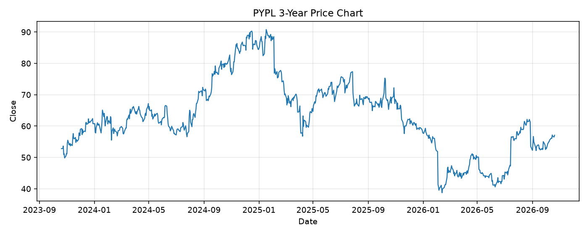

# PYPL レポート

> このページの目的: 単一銘柄のファンダメンタル・価格推移・ニュースを確認し、候補採用可否を判断する。

- 最終更新: 2026-10-20 19:35:26 JST
- 実行ID: 2026-10-20-193526

## 基本情報

- **longName**: PayPal Holdings, Inc.
- **symbol**: PYPL
- **sector**: Financial Services
- **industry**: Credit Services
- **country**: United States
- **marketCap**: 49203048448

## 株価チャート（3年）

## 主要指標

- [指標の見方ヘルプ](../../../../indicators.md)

| 指標 | 値 |
|---|---:|
| PER | 10.79 |
| 配当利回り | 99.00% |
| PBR | 2.48 |
| ROE | 24.50% |
| Debt/Equity | 71.75 |
| 売上成長率 | 4.80% |
| Beta | 1.28 |

## yfinance ニュース

- ニュースが取得できませんでした。

## NewsAPI ニュース

- NewsAPI でニュースが取得されませんでした。
