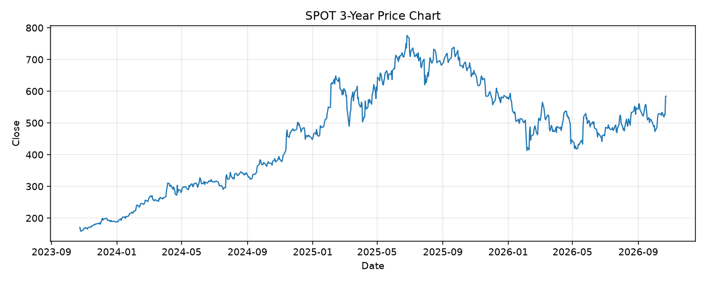

# SPOT レポート

> このページの目的: 単一銘柄のファンダメンタル・価格推移・ニュースを確認し、候補採用可否を判断する。

- 最終更新: 2026-10-25 18:35:34 JST
- 実行ID: 2026-10-25-183534

## 基本情報

- **longName**: Spotify Technology S.A.
- **symbol**: SPOT
- **sector**: Communication Services
- **industry**: Internet Content & Information
- **country**: Sweden
- **marketCap**: 120106401792

## 株価チャート（3年）

## 主要指標

- [指標の見方ヘルプ](../../../../indicators.md)

| 指標 | 値 |
|---|---:|
| PER | 35.60 |
| 配当利回り | 0.00% |
| PBR | 12.23 |
| ROE | 35.81% |
| Debt/Equity | 5.17 |
| 売上成長率 | 16.30% |
| Beta | 1.61 |

## yfinance ニュース

- ニュースが取得できませんでした。

## NewsAPI ニュース

- NewsAPI でニュースが取得されませんでした。
