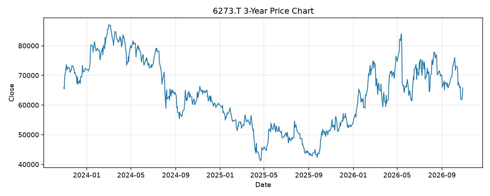

# 6273.T レポート

> このページの目的: 単一銘柄のファンダメンタル・価格推移・ニュースを確認し、候補採用可否を判断する。

- 最終更新: 2026-10-28 20:38:42 JST
- 実行ID: 2026-10-28-203842

## 基本情報

- **longName**: SMC Corporation
- **symbol**: 6273.T
- **sector**: Industrials
- **industry**: Specialty Industrial Machinery
- **country**: Japan
- **marketCap**: 4103992246272

## 株価チャート（3年）

## 主要指標

- [指標の見方ヘルプ](../../../../indicators.md)

| 指標 | 値 |
|---|---:|
| PER | 24.00 |
| 配当利回り | 159.00% |
| PBR | 1.92 |
| ROE | 9.85% |
| Debt/Equity | 0.23 |
| 売上成長率 | 35.40% |
| Beta | 0.83 |

## yfinance ニュース

- ニュースが取得できませんでした。

## NewsAPI ニュース

- NewsAPI でニュースが取得されませんでした。
