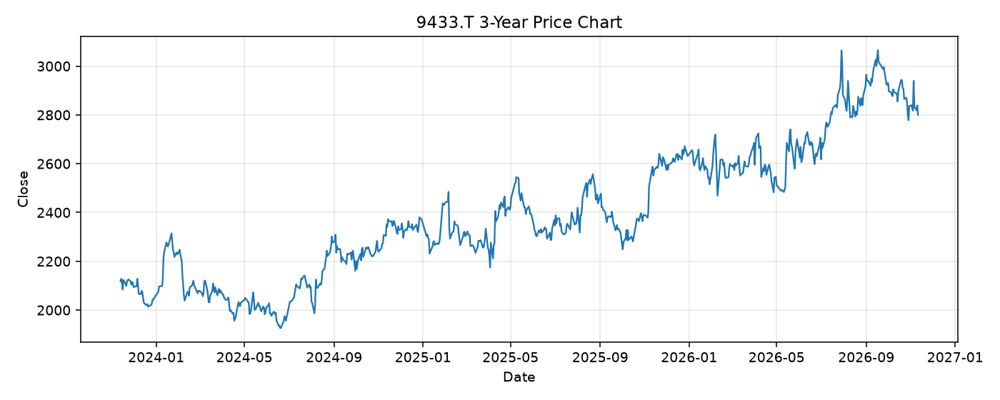

# 9433.T レポート

> このページの目的: 単一銘柄のファンダメンタル・価格推移・ニュースを確認し、候補採用可否を判断する。

- 最終更新: 2026-11-11 22:20:35 JST
- 実行ID: 2026-11-11-222035

## 基本情報

- **longName**: KDDI Corporation
- **symbol**: 9433.T
- **sector**: Communication Services
- **industry**: Telecom Services
- **country**: Japan
- **marketCap**: 10319854305280

## 株価チャート（3年）

## 主要指標

- [指標の見方ヘルプ](../../../../indicators.md)

| 指標 | 値 |
|---|---:|
| PER | 14.89 |
| 配当利回り | 296.00% |
| PBR | 2.07 |
| ROE | 14.51% |
| Debt/Equity | 91.40 |
| 売上成長率 | 5.80% |
| Beta | -0.09 |

## yfinance ニュース

1. [None](None)
2. [None](None)
3. [None](None)
4. [None](None)
5. [None](None)

## NewsAPI ニュース

- NewsAPI でニュースが取得されませんでした。
